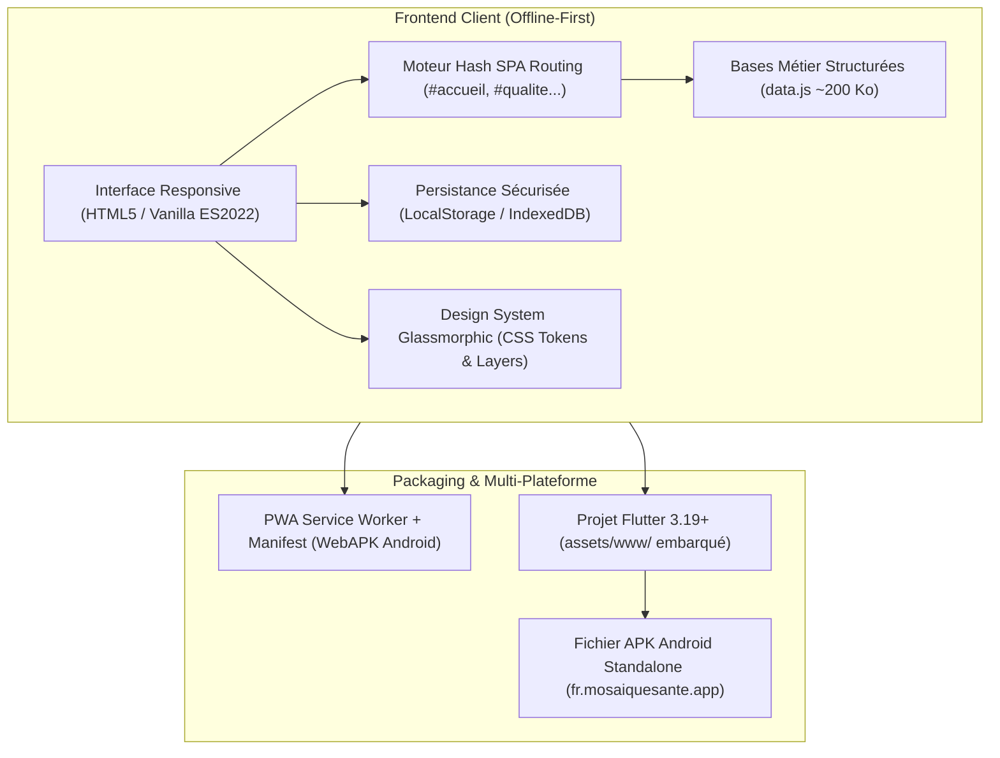
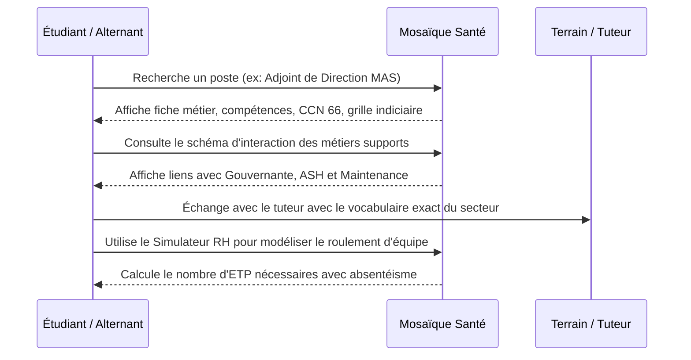
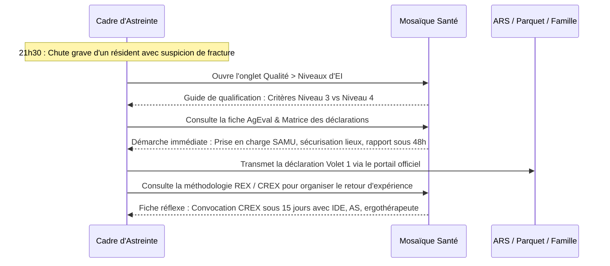

# Fiche de Présentation Officielle — Mosaïque Santé

> **Boîte à outils d'aide à la décision et simulateur de pilotage pour directeurs, cadres et responsables qualité du secteur sanitaire et médico-social.**

---

## 1. Fiche d'Identité du Projet

| Attribut | Spécification |
| :--- | :--- |
| **Nom de l'application** | **Mosaïque Santé** |
| **Version** | `1.4.0` (Production Ready, Multi-plateforme) |
| **Typologie** | Application Progressive Web App (PWA) + Version Mobile Android Native (APK Flutter) |
| **Cible principale** | Étudiants & alternants Master MES (Management des Établissements de Santé, IAE / EHESP / IEP), Directeurs & Directeurs Adjoints d'établissements (MAS, FAM, EHPAD, IME, SESSAD, HAD, CHU), Responsables Qualité et Gestion des Risques (RQGR), Cadres de santé et coordinateurs de parcours |
| **Cadre réglementaire** | Décret d'évaluation HAS 2022, Loi 2002-2, Loi 2005-102, Ségur Numérique, Loi Bien Vieillir 2024, PRS 3 ARS, Réformes de tarification SERAFIN-PH |
| **Accès & Disponibilité** | **100% Offline-First** (aucun serveur distant requis, utilisable en zone blanche ou sous-sol d'établissement) |
| **Formats délivrés** | Application Web Responsive auto-adaptative (Desktop / Tablette / Mobile) + Code source Flutter + Script de build APK Android + Documentation & Pitch commercial |

---

## 2. Galerie Visuelle des Pages & Écrans de l'App

L'interface de Mosaïque Santé utilise un design immersif glassmorphique avec palette contrastée médicale (dark teal & mint / mode clair accessible), typographie optimisée et navigation à 5 piliers thématiques.

### 2.1 Écran d'Accueil & Dashboard Multi-Dispositifs

L'accueil centralise la vue d'ensemble du secteur médico-social et sanitaire, les indicateurs clés, l'accès rapide aux outils de calcul RH et la recherche globale.


```
+---------------------------------------------------------------------------------------+
|  MOSAÏQUE SANTÉ · ESPACE MANAGER                                    [Rechercher...] ☀️|
+---------------------------------------------------------------------------------------+
|  HERO : Comprendre chaque rouage avant de décider sur le terrain                       |
|  Statistiques : 17 Métiers | 8 Corps Supports | 4 Niveaux EI | 20 Logiciels | 10 Lois   |
|  Accès Rapides : [Simulateur RH] [AgEval & EI] [Audits HAS] [Métiers Supports]       |
+---------------------------------------------------------------------------------------+
```

---

### 2.2 Version Mobile & Responsive Auto-Adaptatif

L'application ajuste automatiquement sa mise en page à chaque taille d'écran (smartphone 360–430px, tablette 768–1024px, PC portable 1280–1440px, écran ultra-large 1600–2560px) avec une barre de navigation basse tactile et des tiroirs ergonomiques.

| Vue Smartphone (390 × 844 px) | Vue Tablette (768 × 1024 px) |
| :---: | :---: |
|  |  |

---

### 2.3 Module Qualité, Événements Indésirables & AgEval

Ce module structure le recueil et le traitement des Événements Indésirables (EI) avec intégration de la démarche **AgEval**, la classification par niveau de gravité (1 à 4) et la matrice réglementaire des déclarations externes obligatoires.


**Composants clés affichés :**
- Sélecteur interactif des **4 Niveaux de gravité d'EI** :
  - **Niveau 1 (Presque accident / Dysfonctionnement mineur)** : Résolu en interne, signalement AgEval, analyse en réunion de service.
  - **Niveau 2 (EI sans gravité clinique / Conséquence modérée)** : AgEval, fiche réflexe, retour usager sous 48h, suivi en CREX trimestriel.
  - **Niveau 3 (EI grave potentiel ou avéré)** : Mesures conservatoires immédiates, déclaration sous 48h au portail ARS / Signalement Point Focal, cellule de crise.
  - **Niveau 4 (EIGS / Décès inattendu / Maltraitance caractérisée / Incendie)** : Déclaration volet 1 ARS sous 24h, signalement Parquet (art. 40 CPP), information Président Conseil Départemental, accompagnement psychologique d'urgence.
- **Matrice des Déclarations Externes** : Autorités destinataires (ARS, Parquet, CD, ANSM, ANS), portails officiels (Signalement Santé, télé-déclaration ARS), délais impératifs et bases légales (Code de la santé publique & Code de l'action sociale).

---

### 2.4 Méthodologie des Retours d'Expérience (REX / CREX / RMM)

Un guide pratique pas-à-pas pour mener des analyses systémiques non-punitives suite à des incidents ou des projets complexes.


**Éléments modélisés :**
- **Processus en 6 étapes** : Déclenchement > Chronologie factuelle > Grille ALARM/5M > Plan d'actions > Restitution équipe > Suivi des indicateurs.
- **Les 4 Formats de REX** : CREX (Comité de Retour d'Expérience pluri-professionnel), RMM (Revue de Mortalité et Morbidité médicale), REX Flash (15 min debrief à chaud), REX Institutionnel (post-crise).
- **Facteurs contributifs ALARM** : Facteurs liés au patient, à l'équipe, aux tâches, au contexte institutionnel et organisationnel.

---

### 2.5 Module Audit Qualité HAS & Évaluation ESSMS

Conçu pour outiller les futurs évaluateurs et les équipes préparant l'évaluation quinquennale obligatoire de la Haute Autorité de Santé (HAS).


**Typologies d'audits détaillées :**
- **Accompagné / Patient Traceur** : Rencontre avec la personne accueillie, recueil du consentement, confrontation avec le dossier usager et l'équipe.
- **Audit de Pratiques Cliniques (APC)** : Observation directe de l'administration médicamenteuse, contention, déglutition.
- **Audit Croisé Inter-Établissements** : Évaluation par des pairs d'un autre site associatif pour déjouer l'accoutumance.
- **Audit Flash Environnemental** : Visite inopinée sécurité incendie, chaîne du froid, stockage des produits dangereux.
- **Audit Documentaire & Dossier Unique** : Conformité du DIPC, avenants au projet personnalisé, fiches de traçabilité.

---

### 2.6 Corps de Métiers Support & Matrice d'Interaction

Modélisation complète des métiers sous la responsabilité managériale du dirigeant, souvent absents des manuels théoriques mais cruciaux au quotidien.


**Métiers répertoriés & décryptés :**
1. **Gouvernante d'établissement** : Maîtrise de l'hôtellerie, propreté, linge, accueil des familles.
2. **ASH / ASR (Agents de Service Hospitalier / Réfringents)** : Bionettoyage, hygiène des locaux, aide aux repas.
3. **ASL (Agents de Service Logistique)** : Manutention, livraisons, gestion des flux déchets et DASRI.
4. **Équipe Maintenance & Biomédical** : Sécurité des bâtiments, ERP, maintenance préventive lits médicalisés, lève-personnes.
5. **Logistique, Achats & Approvisionnements** : Gestion des stocks alimentaires, protections, dispositifs médicaux, renégociation des marchés.
6. **Équipe des Systèmes d'Information (DSI / Référent SI)** : Sécurité du DUI (Dossier Usager Informatisé), conformité RGPD, cybersécurité, réseau Wi-Fi usagers.
7. **Équipe Qualité & Gestion des Risques (RQGR)** : Pilotage du PAQSS, cartographie des risques, DUERP, interface avec l'ARS et la HAS.
8. **Guichet Unique Multi-Dispositifs** : Pôle d'accueil, admissions, centralisation des demandes d'orientation MDPH et gestion des listes d'attente.

**Matrice d'interaction transverse :**
Chaque fiche explicite comment ce métier collabore concrètement avec les soignants (IDE/AS), les éducateurs (ES/AMP), la direction et les familles.

---

### 2.7 Politique de Santé & Veille Réglementaire

Ce module contextualise l'action du directeur dans l'architecture institutionnelle française.


**Contenu structurant :**
- **10 Grandes Lois Fondatrices & Récentes** :
  - *Loi 2002-2* (Droits des usagers, 7 outils obligatoires).
  - *Loi 2005-102* (Égalité des droits et compensation du handicap).
  - *Loi HPST 2009* (Création des ARS, CPOM).
  - *Loi ASV 2015* (Adaptation de la société au vieillissement).
  - *Loi de Modernisation de notre Système de Santé 2016* (GHT, virage ambulatoire).
  - *Ségur de la Santé & Ségur Numérique* (Revalorisations carrières, mise à niveau DUI).
  - *LFSS 2022 & Réforme des Services Autonomie à Domicile (SAD)*.
  - *Loi Bien Vieillir 2024* (Prévention de la perte d'autonomie, lutte contre les maltraitances).
  - *Stratégie Nationale TND 2023-2027* (Troubles du neuro-développement).
  - *Feuille de Route Santé Mentale et Psychiatrie*.
- **Le Cadre Régional (PRS 3 de l'ARS)** : Plan Stratégique Régional, Schéma Régional de Santé (SRS), Programme Cadre de Prévention.
- **Le Cadre Départemental** : Schémas autonomie et protection de l'enfance du Conseil Départemental, tarification au titre de l'aide sociale.

---

### 2.8 Panorama des Logiciels Métier

Répertoire commenté des solutions informatiques leaders sur le marché français avec leurs cas d'usage, forces et faiblesses.


**Solutions répertoriées :**
- **DUI & Soins** : NetSoins / NetVie (Teranga), OSIS / Medasys, Hopital Manager (Softway), Titan (Malakoff Humanis), Millésime (Cora), ViaTrajectoire.
- **Gestion des Temps & Planning RH** : Octime, Chronos (Asys), Kelio (Bodet), Agfa Staff.
- **Qualité & Gestion des Risques** : AgEval, BlueMed, Ennov, QualiSanté.
- **Facturation & Comptabilité** : Cegid, Alfa-Lira, Sage Santé, Berger-Levrault.

---

### 2.9 Simulateur RH & Calculateur ETPT

Outil opérationnel pour calculer le coût des remplacements, l'annualisation du temps de travail et le dimensionnement des effectifs.


**Fonctionnalités du simulateur :**
- **Calcul d'ETP / ETPT** : Conversion d'heures réelles en équivalents temps plein selon la durée légale conventionnelle (1 582 h nuit, 1 607 h jour).
- **Coefficient de remplacement (glissement / absentéisme)** : Prise en compte des congés payés, RTT, formations, arrêts maladie moyens.
- **Comparateur salarial CCN 51 / CCN 66 / Fonction Publique Hospitalière**.

---

### 2.10 Annuaire & Réseau de Pairs Sécurisé

Espace de mise en relation et de partage d'expériences entre managers d'établissements.


- **Gestion des profils** : MAS, FAM, EHPAD, IME, Guichet unique.
- **Stockage chiffré local** : Respect absolu du RGPD, aucun transfert vers des serveurs tiers.

---

## 3. Spécifications Techniques & Architecture



### 3.1 Stack Technologique

- **Noyau Applicatif** : JavaScript Vanilla moderne (ES2022), sans framework lourd (React/Vue/Angular) afin de garantir :
  - **Zéro obsolescence** : Le code fonctionne pendant 10 ans sans rupture d'API.
  - **Performance foudroyante** : Chargement instantané en moins de 150 ms.
  - **Empreinte mémoire minime** : Moins de 2 Mo au total.
- **Design System** : CSS modulaire organisé en `@layer` (`tokens`, `reset`, `shell`, `components`, `pages`, `responsive`, `motion`).
  - Palette colorimétrique haute accessibilité WCAG AA.
  - Double thème automatique (Mode Sombre / Mode Clair).
  - Auto-resize dynamique avec unités relatives `clamp()`, `minmax()`, `100vw`.
- **Persistance des données** : Stockage local chiffré dans le navigateur de l'appareil (`localStorage` avec validation de schéma).
- **Offline Engine** : `sw.js` (Service Worker) avec stratégie de cache `Cache-First` pour les assets et `Stale-While-Revalidate` pour les données.

---

## 4. Workflows Utilisateurs Détaillés

### Workflow 1 : L'Alternant / Étudiant Master MES en Prise de Poste



1. **Phase de découverte** : L'étudiant explore les 17 fiches métiers et comprend les différences de responsabilités entre direction générale, direction de site et coordination de parcours.
2. **Phase d'immersion terrain** : Face à une situation complexe (ex: panne d'un ascenseur dans un bâtiment R+3 avec 45 résidents en fauteuil roulant), l'étudiant consulte la fiche **Maintenance & Biomédical** et la procédure de sécurité ERP.
3. **Phase académique & mémoire** : L'étudiant s'appuie sur l'onglet **Politique de Santé** pour sourcer les textes légaux (Loi 2002-2, PRS 3) de son mémoire de Master.

---

### Workflow 2 : Le Cadre d'Astreinte face à un Événement Indésirable



---

### Workflow 3 : Le Responsable Qualité (RQGR) préparant l'Évaluation HAS

1. **Sélection de la méthode** : Le RQGR accède à l'onglet **Audit Qualité HAS** et choisit la démarche **Patient / Accompagné Traceur**.
2. **Grille d'investigation** : Il récupère les 15 questions types recommandées par la HAS concernant le recueil du consentement, le respect de l'intimité et le projet personnalisé.
3. **Audit à blanc** : Il organise un audit croisé avec un cadre d'un autre pôle de l'association pour tester les pratiques avant la venue des évaluateurs externes mandatés par la HAS.

---

## 5. Comment l'Application Fonctionne sous le Capot

### 5.1 Architecture des Données

Toutes les données métier sont regroupées dans un modèle relationnel JavaScript pur (`data.js`) structuré en collections typées :

```javascript
// Architecture des données Mosaïque Santé
const DATA = {
  ESTABLISHMENTS: [...],   // MAS, FAM, EHPAD, IME, SESSAD, CMP, HAD, CHU
  JOBS: [...],            // 17 fiches métiers direction, RH, qualité
  SUPPORT_JOBS: [...],    // 8 corps supports avec matrice d'interaction
  QUALITY_TOOLS: [...],   // AgEval, REX, CREX, RMM, HAS, Patient traceur
  ADVERSE_EVENTS: {...},  // 4 niveaux de gravité, critères, conséquences
  REX_GUIDE: {...},       // 6 étapes, grille ALARM/5M, 4 formats
  AUDIT_GUIDE: {...},     // 6 typologies d'audits, fiches réflexes
  HEALTH_POLICY: {...},   // 10 lois nationales, PRS 3 ARS, échelons
  CONVENTIONS: [...],     // CCN 51, CCN 66, FPH, revalorisations Ségur
  SOFTWARES: [...]        // 20 logiciels métiers (DUI, RH, Qualité, Facturation)
};
```

### 5.2 Moteur de Recherche Full-Text Flou

L'application intègre un moteur d'indexation inversé en mémoire vive :
- Recherche instantanée (temps de réponse < 5 ms).
- Tolérance aux fautes d'orthographe et aux accents.
- Recherche croisée sur tous les domaines (métiers, logiciels, articles de lois, sigles sanitaires).

---

## 6. Déploiement Mobile & Application Android (APK Flutter)

L'application a été conçue pour offrir **deux modes d'installation sur smartphone Android** :

### 6.1 Version APK Native (Flutter 3.19)

Le dossier `flutter_app/` contient le code source complet prêt à compiler :
- **Embarquement local** : L'ensemble du code web est encapsulé dans `assets/www/`.
- **Aucune dépendance réseau** : L'APK fonctionne de manière autonome à 100%.
- **Intégration système** :
  - Gestion matérielle du bouton Retour Android.
  - Barre de statut immersive.
  - Sécurité sandboxée Android.

### 6.2 Version WebAPK Instantanée (PWA)

Sur n'importe quel smartphone Android :
1. Ouvrir le site sur Google Chrome.
2. Menu Chrome (⋮) > **"Installer l'application"**.
3. Le système Android compile automatiquement un **WebAPK** natif avec icône sur l'écran d'accueil, sans nécessiter de téléchargement sur le Play Store.

---

*Fiche réalisée pour la promotion et le déploiement académique de Mosaïque Santé.*
